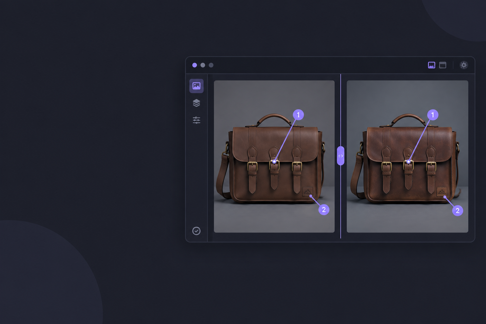

# Creative Review

**Give your AI agent an art director's desk.**



Creative Review is a Hermes plugin (Desktop pane + agent tools + local backend)
that turns "that's not quite right, make the buckle gold and drop the logo" into
a precise, structured revision the agent can act on — and then lets the user
compare, approve and export the result.

Built for the **Nous Research Plugin Hackathon**.

---

## What it does

- **Persistent review boards** — local-first, survive restarts, no account.
- **Side-by-side comparison** of a reference image against generated versions,
  with an optional **overlay slider**.
- **Zoom & pan** on a stage, then **click anywhere** to drop a **numbered point
  annotation** with a note.
- **Version lineage** — every revision is linked to the image it came from.
- **Request Revision** — builds a structured brief (markers, coordinates, notes,
  reference, lineage) and hands it to the **live Hermes conversation** through
  `host.composer.submit()`, so the agent gets it as a real user turn.
- **Approve / reject**, and **export** the approved image plus its full review
  history as JSON or Markdown.

## Install

```bash
# from the catalog (once listed)
hermes plugins install creative-review

# or straight from the repository
hermes plugins install peterpeeterspeter/hermes-creative-review
hermes plugins enable creative-review
```

Then in Hermes Desktop: **Settings → Plugins → Creative Review** and switch the
**Desktop half** on (it ships opt-in), then ⌘K → **Reload desktop plugins** (or
**Rescan** under Capabilities → Plugins).

Requirements: Hermes Agent ≥ 0.22.0. No Python dependencies beyond the standard
library and Hermes' own FastAPI.

## Use

1. Ask Hermes to generate an image. The agent creates a board and registers the
   image (and any reference) with its tools.
2. Open **Creative Review** (sidebar row, ⌘K command, `review N` chip, or docked desk pane). You can also import by absolute image path using **Import image**; paths refer to the selected backend machine.
3. Compare, zoom in, and click the problem spots to add numbered notes.
4. Focus a chat in the board backend profile, then press **Request Revision**. The original target is pinned before saving feedback/building the brief. If that composer accepts the submission, Hermes receives a user turn; otherwise the brief is appended as a draft, without replacing your text. A backend change cancels the handoff.
5. **Approve** the winner and **Export** JSON/Markdown.

Keyboard: wheel zoom; middle-mouse or Alt-drag pan; **Fit** / `f` reset; `↑`/`↓` or `[`/`]` select versions; `a` approves; `r` requests revision. **Locate** centers a marker. Shortcuts are ignored in text fields.

## Architecture

See [ARCHITECTURE.md](ARCHITECTURE.md).

```
plugin.yaml            agent-half manifest (7 tools)
__init__.py            register(ctx): tools + bundled skill
schemas.py             tool schemas (what the model reads)
tools.py               tool handlers
store.py               local-first SQLite persistence
brief.py               structured revision brief builder (shared)
export.py              JSON/Markdown export + approved-image copy
dashboard/             backend REST at /api/plugins/creative-review/*
desktop/plugin.js      Desktop pane: compare, zoom/pan, annotate, revise, approve
skills/creative-review/ bundled agent workflow skill
tests/                 unit tests for store / brief / export
```

## Status & verification

The shipped Python modules and Desktop component code are exercised. The Desktop host SDK is mocked in automated UI tests; these are not live Electron/composer delivery tests.

| Check | Command | Result |
|---|---|---|
| Catalog admission | `hermes plugins validate . --install-deps` | ✅ all green (incl. `desktop surface`, `security scan`, `no core override`) |
| Runtime registration | `hermes plugins doctor .` | ✅ 7 tools, registration passed |
| Unit + tool contract | `python -m unittest discover -s tests` | ✅ 39 passed |
| Backend routes (real ASGI app) | `python tests/integration_backend.py` | ✅ 25 passed |
| Desktop registration | `node tests/desktop_harness.mjs` | ✅ 20 passed |

| Mounted React interactions | `node tests/desktop_mounted.mjs` | ✅ 17 passed (real React/ReactDOM + jsdom, mocked SDK boundary) |

`./scripts/run_tests.sh` runs all six checks with isolated test data. The Node tests resolve React, ReactDOM, jsdom and TanStack Query from `HERMES_AGENT_REPO` (defaults to the local Hermes checkout); these are test dependencies, not plugin runtime imports.

Also exercised end to end in a **real agent conversation**: a one-shot Hermes turn
created a board and registered two images through the live tools
(`hermes chat --cli`), and the backend test read that board back from a fresh
process — persistence across processes, not just within one.

### Not yet verified

- **The visual Desktop pane.** The Electron half loads only after the app
  **Rescans** and the user switches the plugin on under **Capabilities →
  Plugins**. The registration harness only checks declarations. Mounted tests exercise components/handlers but do not verify Electron layout, native SDK controls, real composer acceptance or an image-generation revision turn. Those still need a live app pass.
- **Screenshots / demo recording.** Pending the above; the shot list is in
  [docs/DEMO.md](docs/DEMO.md).

## Privacy & disclosure

- **Local-first.** All state lives in `<HERMES_HOME>/plugin-data/creative-review/`
  (SQLite). Nothing is uploaded.
- **No direct third-party service calls.** The pane uses the authenticated Hermes backend API (which may be remote). Revision submission may invoke your configured model/image provider through Hermes. Registered images remain on the backend machine; the plugin itself does not upload them to a generation service.
- **No credentials, no shell, no background processes, no telemetry.**
- **Exports** are written to the plugin's data folder (or an `out_dir` you give)
  and are not uploaded by the plugin. Each export has a unique directory; unapproved/rejected boards export history only, never an image labelled approved.

## License

MIT — see [LICENSE](LICENSE).